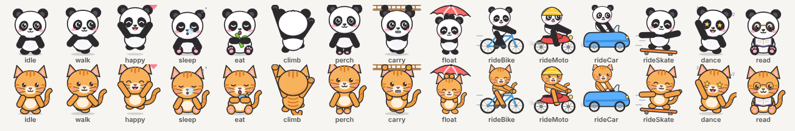

# DesktopPet

A desktop pet for Windows, written in Rust with [Tauri v2](https://v2.tauri.app).
A panda (or a cat, or any pet you add) walks along your taskbar, has moods, and pops up
a speech bubble to remind you of things.



- **Reminders** with repeats, Done / Snooze from the bubble, and typed
  sentences like "call mom tomorrow at 5pm" or "water every 45 min"
- **Quick add** from anywhere (`Ctrl+Alt+R`) and **clipboard to note** (`Ctrl+Alt+N`)
- **Moods and care**: happy, bored, sad, sleepy, hungry; feed it and play with it
- **Roams** the taskbar, the whole screen, or the top of the window you're using
- **Climbs your windows**: scales the side or fetches a ladder, perches on top, jumps between them, floats down with an umbrella
- **Fun**: rides a bicycle, motorbike, car or skateboard; dances; reads a book
- **Computer health**: sweats when the CPU is busy, warns about memory, battery and disk
- **Breaks and focus**: screen-break nudges, a pomodoro timer, a daily summary
- **History** with streaks, **categories** and search, **export/import**
- Windows notifications when the pet is hidden or you're in a full-screen app
- **Swappable pets**: panda and ginger cat built in; add your own

See [SPEC.md](SPEC.md) for the full behaviour.

## Controls

| On the pet | Does |
|---|---|
| Left-click | Pet it |
| Drag | Move it |
| Right-click | Menu: feed, play, climb a window, do something fun, quick add, clipboard note, focus timer, dashboard, hide |

## Build and run (Windows)

You need:

- [Rust](https://rustup.rs) (the default MSVC toolchain)
- Microsoft C++ Build Tools ("Desktop development with C++")
- WebView2: already installed on Windows 10/11

Tauri's own prerequisites page is the source of truth if anything here is out
of date: <https://v2.tauri.app/start/prerequisites/>.

```powershell
cargo run -p desktop-pet          # run in debug
cargo test --workspace            # tests
```

To build an installer, install the Tauri CLI once and bundle:

```powershell
cargo install tauri-cli --version "^2" --locked
cd src-tauri
cargo tauri build                 # installer ends up in target\release\bundle\
```

## Layout

```
crates/pet-core/   platform-independent logic + tests: reminders, typed-time parser, mood,
                   behaviour, system limits, breaks/focus, history, storage, pet packs
src-tauri/         the app: windows, tray, menus, hotkeys, engine loop, Win32 calls (platform.rs)
ui/                pet window, quick-add box and dashboard (plain HTML/CSS/JS)
pets/              built-in pet packs (format: pets/README.md)
tools/             gen-pets.mjs: regenerates the panda and cat art
```

Your data lives in `%APPDATA%\com.thejat.desktoppet\` (`data.json`, `pets\`).

## Status

Early version. The logic is unit-tested and the app compiles for Windows, but
it has not yet been run on a real Windows desktop. See *Known limits* in
SPEC.md for what to check first.

The original C++/Win32 version is on the `main` branch.
